  

  
  
  

# Hey, I'm Gus

CS senior at the University of Houston. I build software from full-stack web apps to graphics programming. I run a freelance business making websites and tools for local businesses in Houston. I also design custom 3D models in Autodesk Fusion to print.

## What I do

- **Websites**: fast, custom-designed sites built with Next.js and React
- **Local SEO**: so people nearby actually find you
- **Branding & graphic design**: logos, social content, visual identity
- **3D modeling & printing**: custom designs in Fusion

## Tech I use

**Languages**

**Web**

**Data & Backend**

**Tools & Design**

## Things I've built

- **[Interactive Maze Game](https://github.com/arriagagustavoo/Interactive-Maze-Game)**: playable game with randomly generated mazes (Python, OpenGL, pygame)
- **[Portfolio](https://github.com/arriagagustavoo/portfolio)**: my personal site
- **Local business sites**: custom Next.js sites with local SEO, designed in Figma first

  

