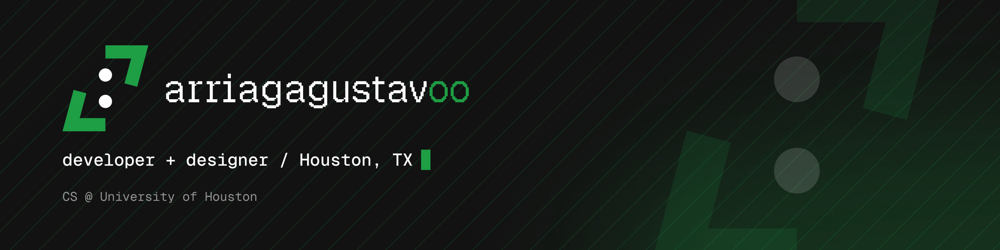

  

# Hey, I'm Gus
 
CS senior at the University of Houston. 
I build software, from full-stack web apps to graphics programming.
I run a freelance business making websites and tools for local businesses in Houston. 
I also design custom 3D models in Autodesk Fusion to print.
 
## What I do
 
- **Websites**: fast, custom-designed sites built with Next.js and React
- **Local SEO**: so people nearby actually find you
- **Branding & graphic design**: logos, social content, visual identity
- **3D modeling & printing**: custom designs in Fusion
## Tech I use
 
**Languages**
 

 
**Web**
 

 
**Data & Backend**
 

 
**Tools & Design**
 

 
## Find me
 
[arriagagustavoo.com](https://arriagagustavoo.com)

[Instagram](https://www.instagram.com/arriagagustavoo/)
 
<!--
**arriagagustavoo/arriagagustavoo** is a ✨ _special_ ✨ repository because its `README.md` (this file) appears on your GitHub profile.

Here are some ideas to get you started:

- 🔭 I’m currently working on ...
- 🌱 I’m currently learning ...
- 👯 I’m looking to collaborate on ...
- 🤔 I’m looking for help with ...
- 💬 Ask me about ...
- 📫 How to reach me: ...
- 😄 Pronouns: ...
- ⚡ Fun fact: ...
-->
